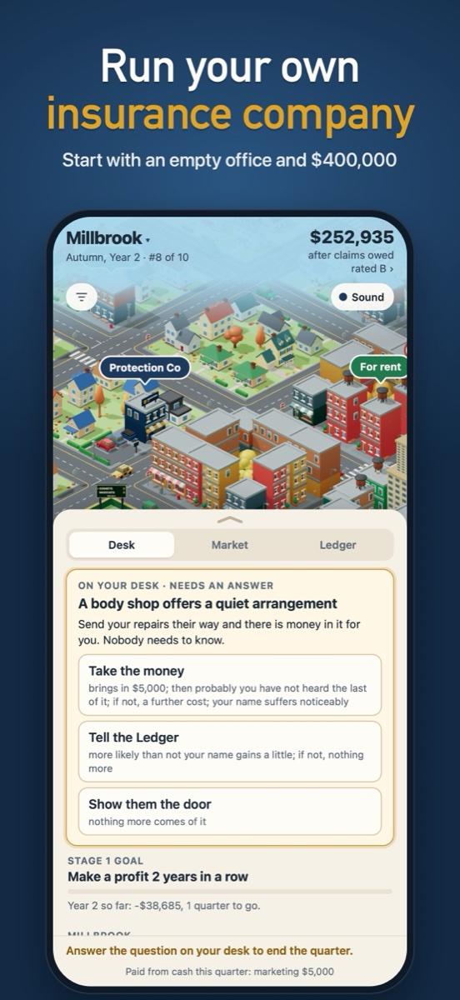
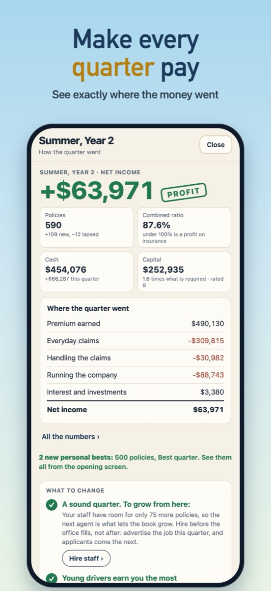

**Protection Co** is a turn-based business game for iPhone about running an auto insurance
company, one quarter at a time.

Start in Millbrook with an empty office, $400,000 and nine rivals. Hire your agents, set your
prices, answer what lands on your desk, and ride out the storms. Win the first stage and grow into
a regional insurer with offices in four towns and a head office of your own.

No ads. No in-app purchases. No account. Plays fully offline.

  
  

- [Support and questions](support/)
- [Privacy policy](privacy/)
